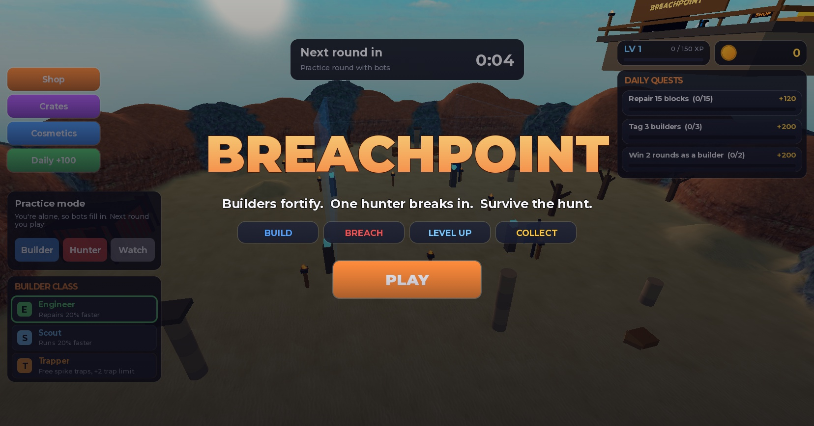
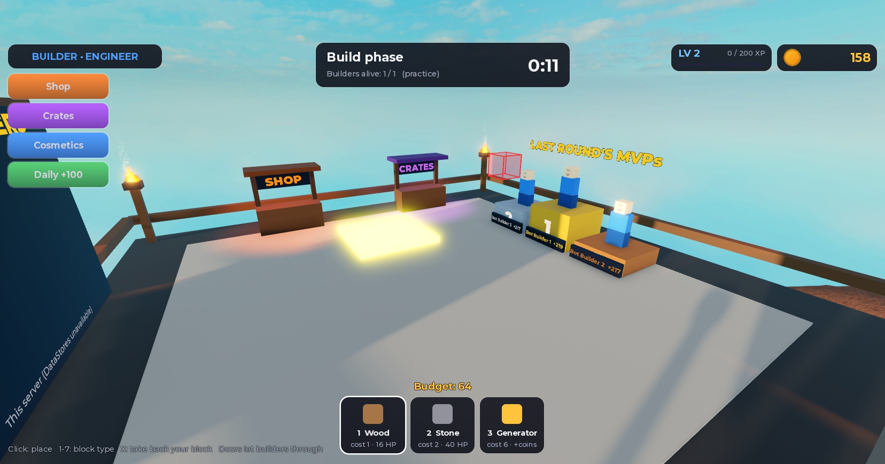
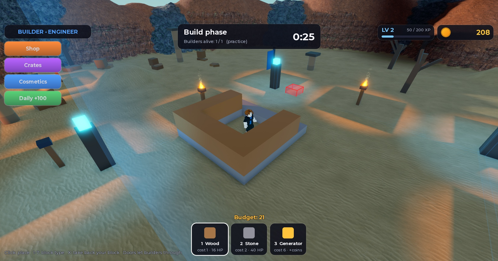
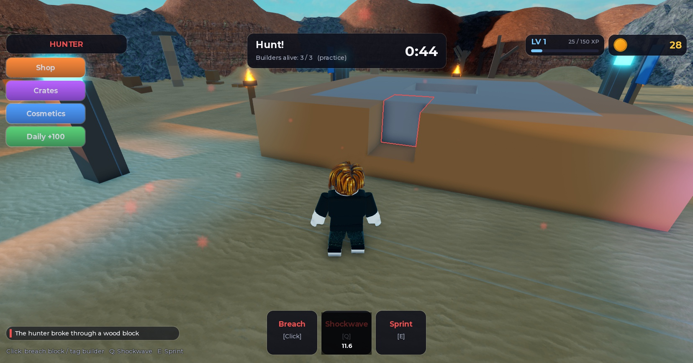
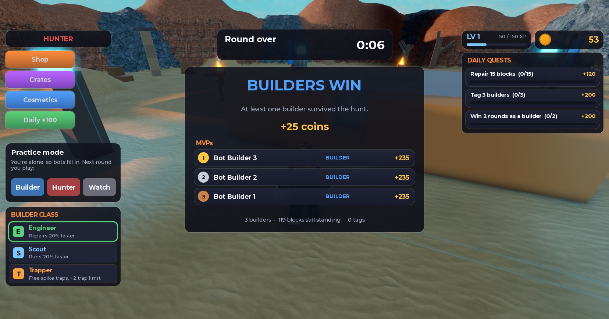
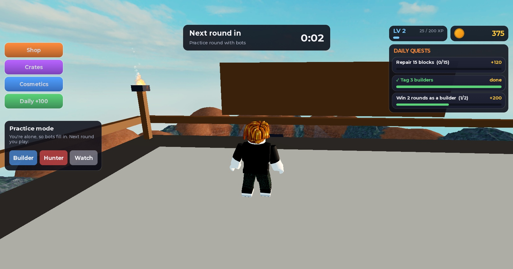
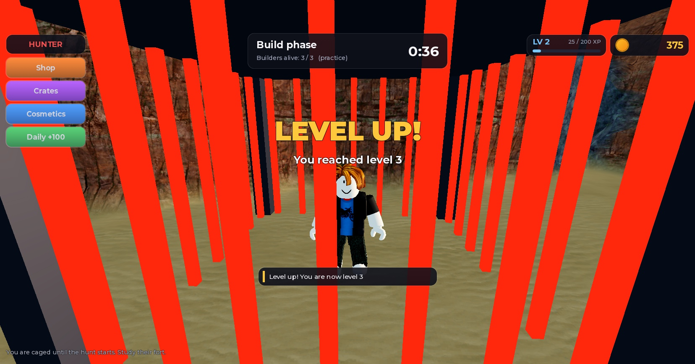
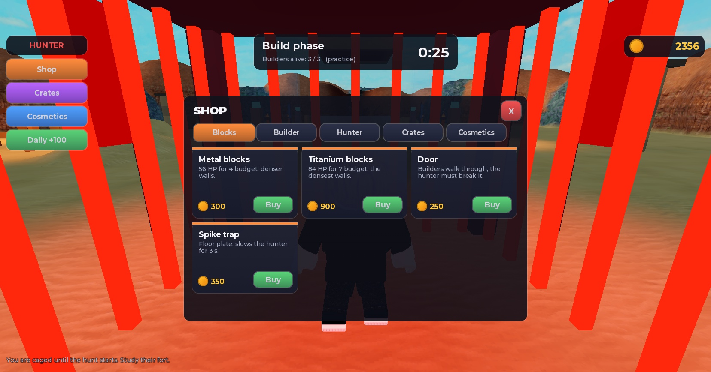
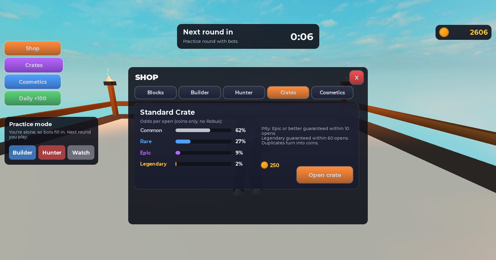
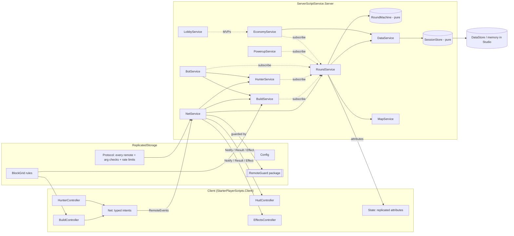

# Breachpoint

**An asymmetric Roblox round game: builders fortify a base, one hunter breaks in.**



Each round, a few players get 50 seconds to wall themselves in with blocks while the hunter waits in
a cage. Then the cage opens: the hunter smashes through walls and tags builders, and the builders
repair what they can and try to outlast the 75-second timer. If one builder survives, the builders
win. If the hunter catches everyone, the hunter wins.

Between rounds, players level up, pick a builder class, finish daily quests, and spend coins in the
shop and on cosmetic crates (coins only, odds shown up front). Balance is measured, not guessed: a
headless simulation runs the real game code for thousands of rounds and fits the hunter's damage to
the team size ([docs/BALANCE.md](docs/BALANCE.md)).

Written in strict, typed Luau with Rojo. The server is authoritative for everything, and the parts
a production game depends on are unit-tested with Lune.

## Showcase

| | |
|---|---|
|  |  |
|  |  |
|  |  |
|  |  |

Studio captures from the game itself (Future lighting). Gameplay GIFs are still to be recorded; see
[docs/media](docs/media/README.md). An accurate feature list is in [docs/FEATURES.md](docs/FEATURES.md).

### Features

**Gameplay**
- Server-controlled rounds: Waiting → Intermission → Build → Hunt → Results, with fair hunter
  selection, and leavers and late joiners handled.
- Building on a 12×6×12 grid with a budget, four block tiers, doors, spike traps and a coin
  generator. Support rules stop floating blocks, and a client ghost preview runs the same rule module.
- Hunter kit: Breach, Tag (needs line of sight), Shockwave and Sprint, all with server cooldowns.
  Builders repair damaged blocks, but not while the hunter is attacking that block.
- **Builder classes** picked in the lobby: Engineer (faster repairs), Scout (faster movement),
  Trapper (free spike traps, +2 trap limit).
- **Power-ups** during the hunt: Shield (blocks one tag), Speed, Decoy (builders), and Reveal pulse
  (hunter: highlights every builder). Spawning, pickup and effects are all on the server.
- Practice mode with bots that use the same brains as the balance simulation, including Watch mode
  (bots on both sides).

**Progression and economy**
- **XP and levels** from round results, with a level-up banner.
- **Three daily quests** (rotating, the same for everyone on a given day) that pay coins.
- Round rewards, a daily login streak, lobby income, and a shop of permanent unlocks (block tiers,
  door, traps, builder perks, hunter upgrades).
- Cosmetic crates: coins only, odds shown, pity counters, duplicates turned into coins, rolled on
  the server, with an animated reveal.

**Lobby and presentation**
- Lobby showpiece: a top-wins leaderboard (OrderedDataStore, with a clearly labelled in-memory
  fallback in unpublished Studio places), a podium with the last round's three MVPs, and shop and
  crate kiosks with proximity prompts.
- Title screen with a camera flyover, a results screen with MVPs and round stats, an event feed
  ("The hunter broke through a stone block", "Alex picked up SHIELD"), coin pop-ups, toasts.
- Everything is built from code: HUD, map (terrain canyon, fort, hunter cage, lobby, props) and
  golden-hour lighting with post effects. The place needs no hand-made content.

**Engineering**
- Guarded networking: every remote is declared in one file with typed argument checks and a
  per-player rate limit. Malformed traffic drains an abuse budget and gets the sender kicked.
- Session-locked player data: `UpdateAsync` locks, stale-lock takeover, autosave, `BindToClose`
  flush, retries with backoff, and schema migrations v1 → v5 that refuse newer data.
- [RemoteGuard](packages/remote-guard): an extracted, reusable, MIT-licensed package with its own
  docs and tests.
- Measured balance: `lune run balance` and `lune run balance calibrate` (see
  [docs/BALANCE.md](docs/BALANCE.md)).
- One command for every quality gate: `lune run check` (format, lint, strict types, 150 unit tests,
  build, build smoke test).

## Where to look

| Resume bullet | Start here |
|---|---|
| Round & role state machine | [RoundMachine.luau](src/server/Round/RoundMachine.luau) (pure flow, tested), [StateMachine.luau](src/server/Round/StateMachine.luau), [RoleAssigner.luau](src/server/Round/RoleAssigner.luau), [RoundService.luau](src/server/Services/RoundService.luau) (side effects) |
| Typed remotes, server validation, rate limiting | [Protocol.luau](src/shared/Protocol.luau) (every remote in one place), [NetService.luau](src/server/Services/NetService.luau) (guards + abuse budget), [BuildService.luau](src/server/Services/BuildService.luau) / [HunterService.luau](src/server/Services/HunterService.luau) (game-rule checks) |
| DataStore: session locking, autosave, BindToClose, retries, migrations | [SessionStore.luau](src/server/Data/SessionStore.luau), [Migrations.luau](src/server/Data/Migrations.luau), [Retry.luau](src/server/Data/Retry.luau), [DataService.luau](src/server/Services/DataService.luau) |
| Progression: XP, levels, daily quests | [Progression.luau](src/server/Economy/Progression.luau) (pure, tested), [EconomyService.luau](src/server/Services/EconomyService.luau), [ProgressController.luau](src/client/Controllers/ProgressController.luau) |
| Classes and server-side power-ups | [BuildService.luau](src/server/Services/BuildService.luau) (`classOf`, loadouts), [PowerupService.luau](src/server/Services/PowerupService.luau), [ClassController.luau](src/client/Controllers/ClassController.luau) |
| Lobby: OrderedDataStore leaderboard, MVP podium, kiosks | [LobbyService.luau](src/server/Services/LobbyService.luau) |
| Reusable open-source module | [packages/remote-guard](packages/remote-guard) ([README / API](packages/remote-guard/README.md), [tests](packages/remote-guard/tests)) |
| Balance (simulation + calibration) | [sim/RoundSim.luau](sim/RoundSim.luau), [.lune/balance.luau](.lune/balance.luau), bot brains in [src/server/Gameplay](src/server/Gameplay), [docs/BALANCE.md](docs/BALANCE.md) |
| Economy, shop, crates | [src/server/Economy](src/server/Economy) (pure: Shop, Crates, Daily, Rewards, Progression), [EconomyService.luau](src/server/Services/EconomyService.luau), [ShopController.luau](src/client/Controllers/ShopController.luau) |
| UI built in code | [src/client/Controllers](src/client/Controllers) (HUD, intro, results, feed, shop), [UI/Create.luau](src/client/UI/Create.luau), [UI/Theme.luau](src/client/UI/Theme.luau) |
| Tooling: Rojo, Selene, StyLua, typed Luau, tests | [rokit.toml](rokit.toml), [.lune/check.luau](.lune/check.luau), [.lune/typecheck.luau](.lune/typecheck.luau), [tests/](tests) |

Background reading: [Features](docs/FEATURES.md) · [Balance](docs/BALANCE.md) · [Architecture](docs/ARCHITECTURE.md) ·
[Decisions](docs/DECISIONS.md) · [Testing & playtest log](docs/TESTING.md) · [Status](docs/STATUS.md) · [Changelog](CHANGELOG.md)

## Architecture



The server is authoritative. Clients send *intents* (`PlaceBlock(x, y, z, kind)`, `Breach(blockId)`,
`Tag(targetId)`), and the server decides. Pure logic modules (RoundMachine, SessionStore,
BlockGrid, RemoteGuard…) take their clock, randomness and storage as parameters, so Lune tests run
them without Roblox. More in [docs/ARCHITECTURE.md](docs/ARCHITECTURE.md).

## Getting started

Prerequisites: [Rokit](https://github.com/rojo-rbx/rokit) and Roblox Studio.

```bash
rokit install          # rojo, selene, stylua, lune, luau-lsp (pinned in rokit.toml)
lune run check         # format check, lint, strict type check, unit tests, build, build smoke test
lune run balance       # balance report: seeded headless rounds, 1-6 builders, with/without upgrades
```

Open the game in Studio, either way:

- **Built place:** `rojo build -o build/Breachpoint.rbxl`, then open `build/Breachpoint.rbxl` and press Play.
- **Live sync:** `rojo serve`, then connect with the Rojo Studio plugin.

Press **Play** alone, then PLAY on the title screen: practice mode starts automatically with bots.
Use the left-hand panels to pick the role for the next round (Builder, Hunter, or Watch to see
bots play both sides) and your builder class. Shop, Crates,
Cosmetics and the daily reward are in the left-hand menu. With 2+ players (*Test → Clients and Servers*), normal rounds run.

| Role | Controls |
|---|---|
| Builder (build phase) | Click: place · 1–7: block type (only unlocked ones are shown) · X: take back your block |
| Builder (hunt phase) | Click or E on a damaged block: repair |
| Hunter (hunt phase) | Click: breach block / tag builder · Q: Shockwave · E: Sprint |

## Testing

- **Unit tests (Lune):** `lune run test` covers the state machine, role fairness, solo and watch
  modes, rate limiter, argument checks, session locking against a mock DataStore (lock contention,
  stale takeover, lost sessions, retries, newer-schema refusal), migrations v1 → v5, XP and daily quests, MVP ranking, the block
  grid, cooldowns, the bot brains (fort planning, weakest-wall breaching, line of sight), the shop,
  the daily streak, end-of-round rewards, and crates (a 200k-roll odds check, both pity
  guarantees, duplicates).
- **Balance simulation:** `lune run balance` (see [docs/BALANCE.md](docs/BALANCE.md)).
- **Live Studio playtests:** every feature was synced into Studio and played through the Studio MCP
  bridge (real mouse and keyboard input, screen captures, server-side assertions). The log, with
  the bugs those runs caught, is in [docs/TESTING.md](docs/TESTING.md), along with a manual
  checklist.

## Tech stack

Luau (`--!strict`) · Rojo 7 · Rokit · Selene · StyLua · luau-lsp (type check) · Lune (tests and
tooling scripts). No third-party runtime dependencies.

## Project layout

```
src/
  server/   Main.server.luau, Services/ (Net, Data, Map, Round, Build, Hunter, Bot, Economy,
            Cosmetics, Powerup, Lobby, Debug), Round/ (RoundMachine, StateMachine, RoleAssigner), Data/
            (SessionStore, Migrations, Retry, MemoryDataStore), Gameplay/ (Cooldowns, FortPlanner,
            HunterBrain, BuilderBrain), Economy/ (Shop, Crates, Daily, Rewards, Progression)
  client/   Main.client.luau, Controllers/ (Hud, Build, Hunter, Shop, Progress, Class, Feed,
            Intro, Effects), Net, State,
            Profile, Pointer, UI/
  shared/   Protocol, Config, Types, Logic/BlockGrid, Util/ (Signal, Cleanup, Log)
packages/
  remote-guard/   the extracted package: src/, tests/, README.md, LICENSE
sim/        headless round simulation used by `lune run balance`
tests/      Lune specs for the game's pure modules + TestKit
.lune/      check, test, typecheck, verify-build, balance, studio-sync scripts
docs/       balance, architecture, decisions, testing log, status, media
```

## Live metrics

> **Placeholder — not published yet.** Breachpoint has not been released on Roblox, so there are no
> visits, CCU or retention numbers. This section will link to the live experience once it's published.

## License

The [RemoteGuard](packages/remote-guard) package is MIT-licensed. The game code is all rights
reserved by the author unless stated otherwise.
