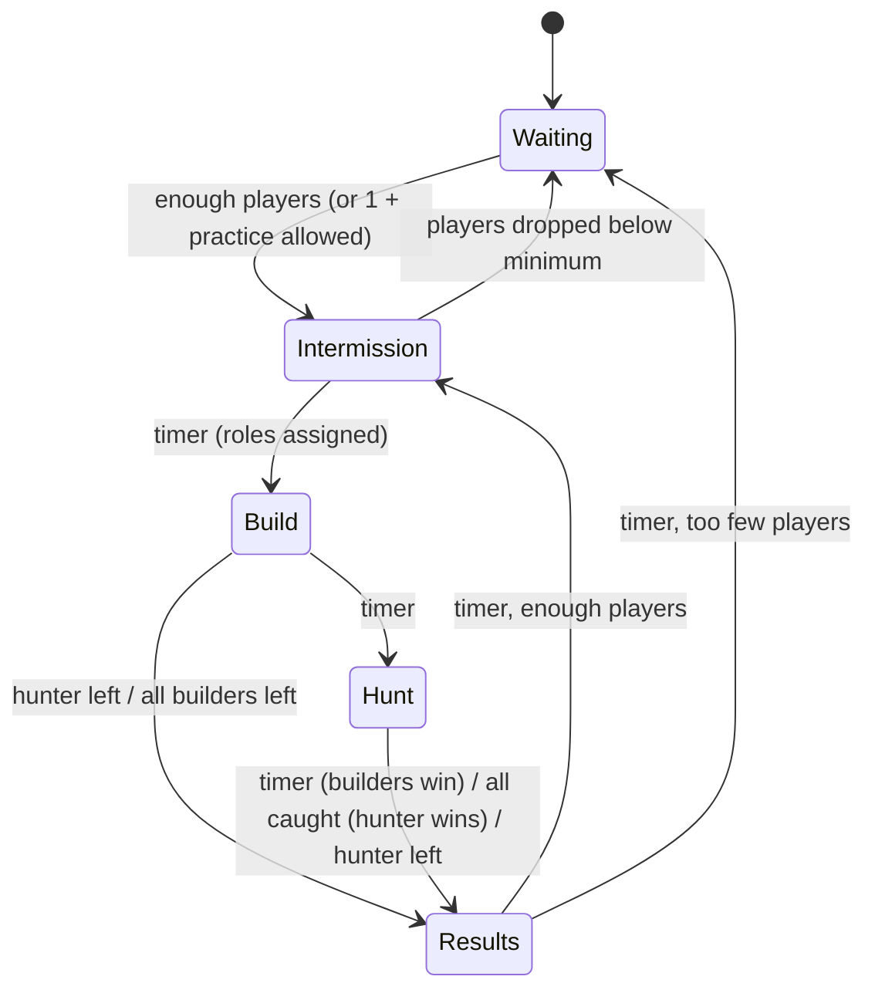

# Architecture

## Principles

1. **The server decides, the client asks.** Clients send intents. The server validates them
   against its own state and replicates the result. No client value is trusted: not a position, not
   a cooldown, not a role.
2. **Pure core, thin Roblox shell.** Anything with real logic lives in a pure module that receives its
   dependencies (clock, randomness, storage). Services wrap these modules and do the Roblox side
   effects. The core is unit-tested under Lune; the shell is covered by live Studio playtests.
3. **One place per concern.** Every remote is declared in `Protocol`, tuning lives in `Config`, and
   shared types live in `Types`. A payload's shape is written down exactly twice: in `Protocol` (runtime
   checks) and in `NetService.Handlers` / client `Net` (static types).
4. **One-way dependencies.** `RoundService` emits Signals, and gameplay services subscribe. Nothing
   calls "up" into the round, so there are no require cycles.

## Runtime layout (Rojo)

| Repo path | Studio path | Contents |
|---|---|---|
| `src/server` | `ServerScriptService.Server` | `Main` script, services, round/data/gameplay logic |
| `src/client` | `StarterPlayer.StarterPlayerScripts.Client` | `Main` local script, controllers, UI helpers |
| `src/shared` | `ReplicatedStorage.Shared` | Protocol, Config, Types, BlockGrid, utilities |
| `packages/remote-guard/src` | `ReplicatedStorage.Packages.RemoteGuard` | the extracted package |

Pure modules reach their siblings through string requires (`require("./RoleAssigner")`), which
Roblox and Lune resolve identically. Roblox-bound modules cross Rojo roots with instance paths.

## Server boot

`Main.server.luau` lists the services in order and calls `init()` on each, then binds every network
handler, then calls `start()` on each:

```
DebugService → NetService → DataService → MapService → RoundService → BuildService → HunterService
→ BotService → EconomyService → CosmeticsService
```

- `init()` creates state and instances (remotes, map, RoundState folder) and may yield for boot IO
  (the DataStore probe).
- `start()` connects events and starts loops.

`NetService.bindHandlers` takes one table typed as `NetService.Handlers`, so a missing or
mis-typed handler is a type error. It also asserts at runtime that the handler set matches
`Protocol` exactly.

## Round flow



`RoundMachine` is pure and deterministic. `RoundService` feeds it time (Heartbeat `dt`), presence
(`addPlayer`/`removePlayer`) and validated game events (`tag`, `eliminate`). After every mutation
it drains the machine's event queue (`PhaseChanged`, `RolesAssigned`, `Eliminated`, `RoundEnded`)
and handles each event in isolation, so one failing side effect can't swallow the events after it.

Edge cases handled in the machine (each has a spec):

- A player leaving mid-round is eliminated with reason `Left`.
- The hunter leaving voids the round (`None` / `HunterLeft`), so leaving can't be used to farm wins.
- All builders leaving untagged voids the round. If some were caught, the hunter wins.
- A builder dying counts as caught. The hunter respawns instead.
- Late joiners spectate until the next round.
- Solo is re-decided when Build starts, because someone may have joined or left during the countdown.

Clients render from replicated attributes rather than from events, so a player who joins
mid-round sees correct state immediately. Round state lives on `ReplicatedStorage.RoundState`
(`Phase`, `EndsAt` in server time, `Round`, `Solo`, `HunterId`, `BuildersAlive`/`BuildersTotal`).
Per-player state lives on the `Player` (`Role`, `Alive`, `Budget`).

## Networking

```
client intent ──► RemoteEvent ──► RemoteGuard (rate limit → arg count → arg checks) ──► handler
                                         │ reject                                        │
                                         ▼                                               ▼
                               abuse budget (kick on drain)          game rules: phase, role, ownership,
                                                                     distance, line of sight, cooldown
                                                                                         │
                                                       ActionResult(ok, reason) ◄────────┘
```

- **Layer 1 (shape), RemoteGuard:** types, ranges, NaN/inf, string length and UTF-8, enum
  membership, extra-argument smuggling, and a per-player token bucket per remote.
- **Layer 2 (rules), the owning service:** e.g. `BuildService.tryPlace` checks phase → alive
  builder → budget → server block cap → grid rules → reach → no character overlap. Cooldowns are
  consumed *last*, so a rejected request never burns an ability.
- **Abuse budget:** every rejection costs points (rate-limited 1, malformed 5). Honest clients never
  send malformed payloads, so draining the budget gets the sender kicked. Server-to-client remotes
  also listen server-side, so a client firing them is charged instead of filling Roblox's invocation
  queue.
- **Feedback:** each intent gets an `ActionResult(action, ok, reason)`. The HUD shows rejections as
  toasts, and ability cooldowns start only on a confirmed `ok`.

## Player data

```
PlayerAdded → wait for any in-flight release of the same user on this server
            → SessionStore:load (UpdateAsync: check lock → migrate → write our lock)
            → if the player already left: release immediately
autosave    → SessionStore:save (UpdateAsync: verify we still own the lock → write + refresh timestamp)
PlayerRemoving / BindToClose → save with release (lock cleared); saves per player are serialised
```

Stored record: `{ version, data, lock = { jobId, placeId, at }?, savedAt }`.

| Situation | Behaviour |
|---|---|
| Lock held by another live server | retry with backoff (1, 2, 4… s, jittered); then kick with "still in use" |
| Lock older than `LockExpiry` (300 s, i.e. 5 autosaves) | treated as a crashed server, taken over (logged) |
| Lock already ours (same-server rejoin) | loaded immediately |
| Our save finds a foreign lock | write cancelled, session marked lost, player kicked; never overwrites newer data |
| Record from a newer schema | load refused and the record left untouched |
| DataStore errors | retried with exponential backoff + jitter, then reported |
| Studio, unpublished place | in-memory store, with a notice in the output |
| Live server, probe fails | still uses the real store; never silently drops to memory |

`SessionStore`, `Migrations`, `Retry` and `MemoryDataStore` are pure, and the specs drive them with
two simulated servers sharing one store and one fake clock.

## Building and hunting

- **BlockGrid** (shared, pure) is the model: integer cells inside fixed bounds, occupancy, support
  (ground or a face-neighbour), damage and repair. The server's instance is the truth. Block parts
  in `workspace.Map.Blocks` only display it, carrying `BlockId` / `Health` attributes for clients.
- The client's **BuildController** mirrors replicated blocks into its own BlockGrid (`insert`, which
  tolerates any replication order) to colour the ghost preview with the *same* rules. Invalid
  placements are caught locally and never sent.
- **Fort barrier:** builders are kept inside the fort by walls in a `FortBarrier` collision group
  that collides only with the `Builders` group. The hunter walks through them. The barrier is
  `CanQuery = false`, so it never blocks targeting or line-of-sight rays.
- **Tag line of sight:** two rays (body-to-body and head-to-head). A builder fully walled in is
  safe, but a gap at either height exposes them.

## Client

`Main.client.luau` starts four controllers. **HudController** owns the ScreenGui and exposes
`toast` / `playSound`. **BuildController** and **HunterController** add their own bars and react
to `State.changed`. **EffectsController** turns server `Effect` events into local debris, rings and
sounds. `State` wraps the replicated attributes in typed getters, and `Net` wraps every remote in a
typed function.

## Practice bots and the balance simulation

The bots' decisions live in three pure modules under `src/server/Gameplay`:

- **FortPlanner:** pooled budgets become concentric two-high rings around an n×n interior. The
  kind per ring is brute-forced to maximise the HP of the weakest column, and a ring is only
  planned if it can be closed completely.
- **HunterBrain:** Dijkstra over ground columns, where a blocked column costs travel time plus
  its HP divided by breach damage per second. The hunter targets the cheapest builder, breaches
  the weakest point, tags when in range with line of sight (two rays, like HunterService), uses
  Shockwave when surrounded and Sprint on long open runs.
- **BuilderBrain:** repair the most damaged block in reach.

`BotService` gives these brains bodies in Studio and calls `BuildService.tryPlace/tryRepair` and
`HunterService.try*`, the same validated functions as human requests. `sim/RoundSim.luau` runs
the same brains headless against the real `BlockGrid` and `Cooldowns` with a fake clock. That
lets `lune run balance` play thousands of seeded rounds, with model assumptions listed in
[BALANCE.md](BALANCE.md).

## Economy

All rules are pure modules in `src/server/Economy`, with Config passed in: **Shop** (permanent
unlocks), **Crates** (odds, pity, prize pools, duplicate refunds), **Daily** (UTC-day streak) and
**Rewards** (end-of-round coins). `EconomyService` is the glue:

```
BuyItem / OpenCrate / Equip / ClaimDaily ─► RemoteGuard ─► EconomyService ─► DataService.mutate(fn)
                                                                   │                 │ (atomic, no yield)
                                     CrateResult (reveal) ◄────────┘                 ▼
                                     Profile snapshot ◄──────────── DataService.changed (batched per frame)
RoundService.roundEnded ─► Rewards.compute (+ BuildService.standingByOwner) ─► coins, wins, RoundResult
```

Per-action coins (repairs, breaks, generator payouts) are paid where the action happens. Crate
rolls use a server-side `Random.new()`; the client only animates toward the result it is sent.
Perks are read once per round at role assignment (BuildService budgets and repair cooldowns,
HunterService damage and Shockwave cooldown). Cosmetics are visual only: skins tint blocks,
CosmeticsService shows titles and hunter trails, and only applies real changes, because data
changes fire on every coin.

## Progression, classes, power-ups, lobby (0.3.0)

- **Progression** (`Economy/Progression.luau`, pure): level curve, `addXp`, quests for a day,
  `record(stat, amount)`. `EconomyService` adds XP after round rewards and listens to
  `DataService.incremented` to advance quests, paying quest coins inside the same `mutate`.
- **Classes:** the `Class` player attribute is set by `BuildService.onChooseClass` (validated by
  Protocol's literal check). The class is folded into the builder loadout at role assignment
  (repair multiplier, trap limit, Scout walk speed) and reset between rounds.
- **Power-ups** (`PowerupService`): spawns during the hunt (builder kinds on free fort cells, the
  hunter's outside), a 0.2 s server loop checks pickup distance, effects are applied on the
  server. Shield is an attribute consumed in `HunterService.tryTag`.
- **Lobby** (`LobbyService`): builds the leaderboard board, podium and kiosks; listens to
  `EconomyService.roundRewarded(outcome, mvps)`; leaderboard via OrderedDataStore or the in-memory
  fallback.
- **Client:** `ProgressController` (level, quests, banner), `ClassController`, `FeedController`
  (notify kind `feed`), `IntroController` (title screen); results MVPs in `HudController`.

## Tooling

| Command | What it does |
|---|---|
| `lune run check` | All gates: StyLua check, Selene, luau-lsp strict type check, Lune tests, `rojo build`, build smoke test |
| `lune run test [filter]` | Unit tests |
| `lune run typecheck` | luau-lsp analysis with Roblox definitions and a Rojo sourcemap |
| `lune run verify-build` | Opens the built `.rbxl` and checks every script is present, correct class, same source |
| `lune run studio-sync` | One-way sync server for live testing without the Rojo plugin (see DECISIONS D5) |
